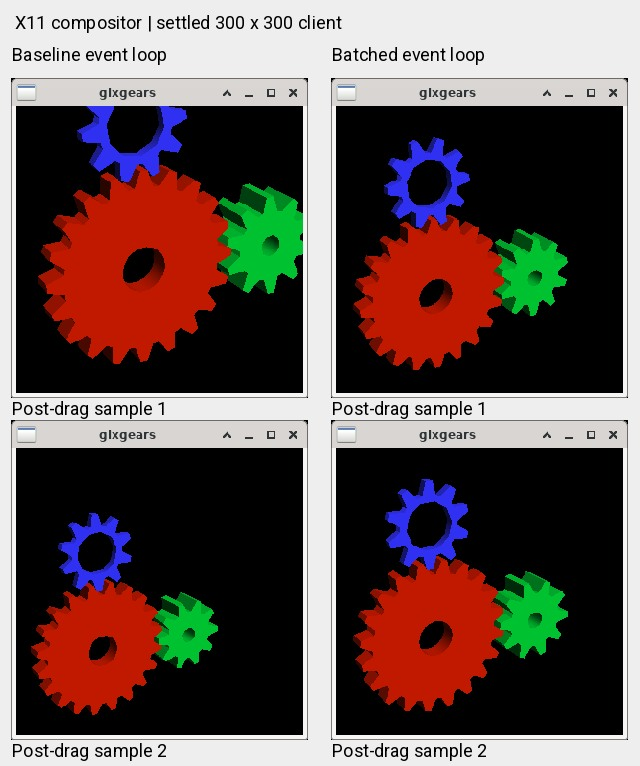

# S40: demo event batching and S39 launch integration

## Result and scope

Validated on the S26 Ultra on 2026-10-31. S40 adds a private **glxgears event-loop
patch**, repairs the shared S39 launch allowlist, and provides an entry point
that requires the actual S39 server and selects the intended private clients.
The server remains the pinned S39 binary; Vulkan uses the existing S39
Configure-coalesced vkcube and unchanged S26 wrapper ICD.

The user's desktop was S38, PID 19846, with XFCE PID 20036 during this work.
All graphics measurements used disposable authenticated Xwayland/XFWM sessions.
The final test receipts report the user session unchanged. A user-controlled
S39 restart is still necessary to select the repaired launch path.

This is a fix to the two demo applications' event processing and their launch
selection. It is not a general Mesa driver, Android helper, or glibc validation.

## Confirmed glxgears failure

Mesa demos 9.0.0 `handle_event()` returns `DRAW` for every Expose, and its
`event_loop()` immediately breaks out of event processing on that result.
A newer Configure can already be queued while a frame is drawn with the
viewport from an older Configure. Meanwhile the GLX/Kopper path obtains the
current drawable extent. A historical viewport inside a current framebuffer
produces oversized gears cut off at the top, or small gears anchored at the
bottom-left.

This was visible in both the named frame pixmap and the X11 compositor overlay,
including after the window had settled at 300 x 300. A same-source diagnostic
baseline recorded **199 frames with a non-300 x 300 requested viewport after
the drag ended**, with the last one **1,661 ms after the end**, and a maximum
local Xlib queue of **362 events**. The view orientation stayed at
`20.0,30.0,0.0`, excluding accidental arrow-key/view changes. These trace
values describe application requests, not queried GPU viewport state.

The patch drains pending Expose and input events, retains the latest Configure
size, applies one `reshape()` for the batch, and then draws. Escape, pause,
unpause, arrow input and blocking while paused remain covered by the event
regression test. No timer-based debounce or artificial frame repetition was
added.

### Final same-build comparison

Both private binaries were built from the same pinned upstream file and compiler
command. The candidate differs only in `event_loop()`. Both used S39, S26,
12 seconds of real XFWM dragging, 8 ms pointer steps, an aspect-preserving
100..500 pixel trajectory, and the same capture method. Only Xwayland had the
dual-ABI interposer; neither the WM nor the client had `LD_PRELOAD`.

| Measurement | Baseline glxgears | Batched glxgears |
|---|---:|---:|
| Core drag captures | 29 | 29 |
| Captures with no detected blue gear pixels | 5 | 0 |
| Captures with blue pixels reaching the top edge | 5 | 0 |
| All captures retaining red, green and blue | 35 / 40 | 40 / 40 |
| Blue vertical bounds in five settled 300 x 300 captures | 0..78, 69..147, 33..126, 33..126, 36..126 | 33..126, 33..126, 36..126, 33..126, 36..126 |

The baseline still generated 1,346 X Present COPY completions in the measured
core interval. Thus a high completion count alone would have missed this
visual failure. The candidate generated 1,191; this change is not presented as
an FPS increase. Its maximum observed completion-receive gap was 59 ms.



The figure uses final baseline and candidate captures 35 and 36. Every panel
has a 300 x 300 client. Capture pairs are separate test runs, not the same GPU
frame. Labels identify the application variant; pixels are real X11 overlay
readbacks.

## Vulkan result and correct client selection

No additional vkcube logic change was justified in S40. The existing S39 client
already batches Configure events instead of recreating a swapchain for every
intermediate size. The unmodified same-build baseline still starves under the
final 12-second mixed-aspect drag:

| X11 observer measurement | Baseline vkcube | S39 coalesced vkcube |
|---|---:|---:|
| COPY completions in core drag interval | 0 | 447 |
| 500 ms core bins without a COPY completion | 22 | 0 |
| Maximum completion-receive gap | 13,616 ms | 74 ms |

The coalesced run also captured changing cube orientations during dragging.
These are X11 compositor images, not Android physical-display frames. Both
coalesced clients passed 200 x 1, 200 x 2, 400 x 1, then 500 x 500 restoration,
fixed-size animation checks, and Escape exit code 0. There was no tested
client/server crash.

## S39 launch integration repair

`termux/alroot-wayland` previously admitted private KGSL stages only through
S38, although `start-s39-live-resize.sh` selected S39 and enabled its flags.
That mismatch could reject the S39 launch after a restart had stopped XFCE.
It was a missing integration step; there is no evidence that the launcher
silently fell back from S39 to S38.

The common guard now lives in `termux/xwayland-gpu-profile.sh`. It admits S39
with the complete inherited profile and both S39 flags, while retaining the
older stage rules. The S39 starter and `awstart` call the same guard **before
stopping a session**. The final startup guard tests cover 26 profile cases and
8 actual launcher-dispatch cases using inert CLI fixtures. The original
launcher is a negative control: an invalid mixed profile reaches the stop
stub, whereas the repaired launcher rejects it before any CLI call.

`run-s40-resize-visual.py` always selects S26 plus the appropriate pinned demo,
and requires the validated live label `S39_KGSL_RESIZE_ORIGIN_ROOT_POOL`.
It rejects S38 before opening a demo, with the S39 startup command in its error.
The older S24 runner keeps installed-client defaults for existing comparisons.

## Use on the device

Save desktop work and run the restart from a separate **native Termux shell**:

```sh
cd /data/data/com.termux/files/home/alroot_wayland
bash graphics/tools/start-s39-live-resize.sh --restart
```

Run each demo separately, or close the first before starting the next:

```sh
python graphics/tools/run-s40-resize-visual.py zink
python graphics/tools/run-s40-resize-visual.py vulkan
```

The server stays S39; the name S40 identifies the new glxgears patch and the
validated demo-selection entry point. Plain `glxgears` or `vkcube` still runs
the installed package, not the selected private test build.

Rollback the project desktop from a separate native Termux shell:

```sh
bash graphics/tools/start-s39-live-resize.sh --restore-s38
```

## Reproduce the build and tests

```sh
python graphics/tools/build-s40-glxgears.py --dry-run
python graphics/tools/build-s40-glxgears.py
python graphics/tests/test-s40-glxgears-events.py
python graphics/tests/test-s40-kgsl-profiles.py termux/xwayland-gpu-profile.sh
bash graphics/tools/start-s39-live-resize.sh --restart --dry-run

python graphics/tools/test-s40-live-resize.py --demo zink --client baseline --trajectory aspect --capture
python graphics/tools/test-s40-live-resize.py --demo zink --trajectory aspect --capture --thin --close-client
python graphics/tools/test-s40-live-resize.py --demo vkcube --client baseline --trajectory mixed --expect-starvation
python graphics/tools/test-s40-live-resize.py --demo vkcube --trajectory mixed --capture --thin --close-client
```

The graphics harness defaults to 12 seconds of dragging plus pre/post observation.
`PASS` checks X11 submission progress, process health and optional thin/close
checks. It is **not an automatic visual/rotation PASS**; inspect `content.log`
and the images as well. The baseline glxgears can pass the liveness gate while
its viewport is visibly wrong. Capture is diagnostic CPU readback at 400 ms;
it does not prove the absence of single-frame flicker between samples.

The builder fetches the pinned official release if its cached archive is absent,
extracts only `glxgears.c`, reproduces both expected ELF hashes before publishing,
and never installs either binary. It refuses replacement of a running private
client and records the installed executable's before/after hashes. The final
on-device formal rebuild reproduced both binaries exactly.

### Pinned provenance

- Upstream: <https://archive.mesa3d.org/demos/mesa-demos-9.0.0.tar.xz>
- Archive SHA-256: `3046a3d26a7b051af7ebdd257a5f23bfeb160cad6ed952329cdff1e9f1ed496b`
- Baseline source: `344a03aff01708350d90603fd6b841bccd295157670f519b459bbf3874acf847`
- Coalesced source: `d4ca3fe86499fc4618dcba03332351d99e35bcee281c6dac60a0904f0f6ac3a3`
- Patch: `graphics/patches/mesa-demos/9.0.0/0001-glxgears-coalesce-xevents.patch`
- Patch SHA-256: `5ec33f1017fe6f53e402b148130542734471118a3456f672a00b20a367bffd85`
- Baseline ELF: `b0a7c8225211cc61467e0ae18db12a99efd01d1c8ba383c887fbd6469eea203f`
- Coalesced ELF: `4f5444726d455d522ebaf37b17760febc028db4f6653dcd237517913c836e086`
- S39 server: `c5f6c9a512f84e31f60ec52a9f10e689e0746f831049e57a4223ade2750f3899`
- S39 coalesced vkcube: `0050e7126c8d096cd14a7e0b1026b7063f898e33eb7be5b80116991cee57c208`

### Receipts

Final logs are relative to `.source/gpu-stage1/s40-resize-diagnostics/logs/`:

- `formal-zink-baseline-interactive-8ms-20261031-213417-803`
- `formal-zink-coalesced-interactive-8ms-20261031-213150-23905`
- `formal-vkcube-baseline-interactive-8ms-20261031-213436-802`
- `formal-vkcube-coalesced-interactive-8ms-20261031-213251-28937`

The earlier traced baseline is
`formal-zink-installed-interactive-8ms-20261031-212555-7243` in the same directory.
Despite that diagnostic directory's inherited `installed` label, its receipt
records the exact private `glxgears.baseline-trace` executable and SHA. That
preliminary diagnostic also preloaded the interposer into the WM; the four
final comparisons above corrected this to Xwayland only.

Build and semantic/startup receipts are under
`.source/gpu-stage1/s40-demo-events/` (`glxgears-build-manifest.json` and `logs/`).
The first experimental named-pixmap capture had missing XImage RGB masks and
produced invalid black images; those images were excluded. The committed
capture probe obtains the matching TrueColor Visual masks and verifies depth.

A separate client/frame shared-pixmap coordinate candidate was investigated.
Ordinary framed resize phases passed on both S39 and the candidate; only an
explicit redirect/unredirect sharing transition demonstrated a decoration
write. That candidate and its trace binary were **not selected or shipped** as
a fix for the glxgears resize report. S40 retains the S39 server and its existing
release-fence/frame-lifetime protections.
